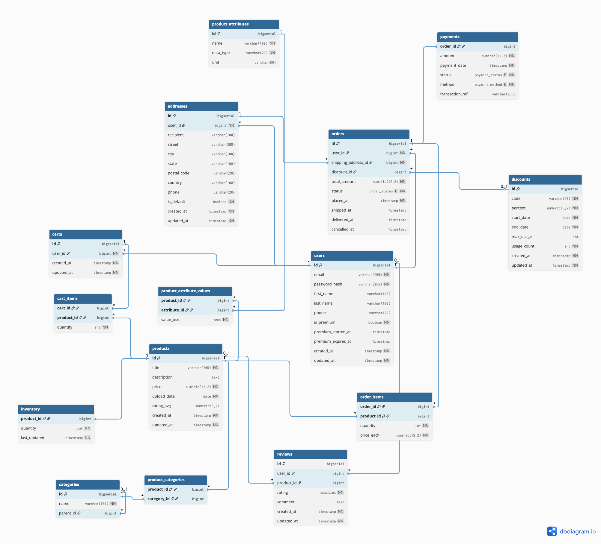

# DigiKala-Style E-Commerce Database (PostgreSQL)

A relational database for an online retail platform modelled after [DigiKala](https://www.digikala.com/), built as the term project for my university **Database Lab** course.

The project has two phases:

1. **Design**: an ERD, a normalized PostgreSQL schema (with an EAV model for product attributes), sample data, and a written design rationale.
2. **Querying**: 24 analytical queries and triggers covering recursive CTEs, multi-level aggregation, EAV filtering, and PL/pgSQL triggers for inventory, auditing, and data integrity.



---

## Repository structure

```
.
├── sql/
│   ├── 01_schema.sql                 # Enum types, 16 tables, foreign keys, indexes
│   ├── 02_sample_data.sql            # Seed data (users, products, orders, reviews, ...)
│   └── 03_queries_and_triggers.sql   # Phase 2: 24 queries & triggers
└── docs/
    ├── erd.png                       # Entity-Relationship Diagram (dbdiagram.io)
    ├── phase1_design_report.pdf      # Design rationale for every table and relationship
    ├── phase2_queries_report.pdf     # Explanation of each query/trigger
    └── assignment/                   # Original course assignment specs
        ├── phase1_spec.pdf
        └── phase2_spec.pdf
```

## Quick start

Requires **PostgreSQL 11+** (tested on PostgreSQL 14).

```bash
createdb digikala
psql -d digikala -f sql/01_schema.sql
psql -d digikala -f sql/02_sample_data.sql
psql -d digikala -f sql/03_queries_and_triggers.sql
```

Or run it with Docker, no local install needed:

```bash
docker run --name digikala-db -e POSTGRES_PASSWORD=postgres -v "$PWD/sql":/sql -d postgres:16
sleep 5 && docker exec -it digikala-db sh -c 'for f in /sql/*.sql; do psql -U postgres -f "$f"; done'
```

> `03_queries_and_triggers.sql` creates helper tables and triggers and runs a few test inserts, so it changes the data. To play with the queries one by one, load the first two files and copy individual queries into `psql` or your SQL client.

## Schema overview

The schema is in third normal form, with a few deliberate denormalizations. Tables are grouped by domain:

| Domain | Tables | Highlights |
|---|---|---|
| **Users & identity** | `users`, `addresses` | Unique email login, hashed passwords, premium membership with start/expiry dates, multiple addresses per user with a default flag |
| **Catalog** | `products`, `categories`, `product_categories`, `product_attributes`, `product_attribute_values`, `inventory` | Self-referencing category tree of any depth, many-to-many product↔category, **EAV** for variable specs (color, weight, storage...), stock kept in its own table |
| **Shopping** | `carts`, `cart_items`, `discounts` | One active cart per user, discount codes with validity windows and usage limits |
| **Order-to-cash** | `orders`, `order_items`, `payments` | Order status lifecycle, per-item price snapshot (`price_each`), 1:1 payment record |
| **Social proof** | `reviews` | One review per user per product, enforced by a unique index |

**Custom enum types:** `order_status` (Pending / Shipped / Delivered / Cancelled), `payment_status` (Pending / Successful / Failed / Refunded), `payment_method` (CreditCard / OnlineBanking / Wallet).

### Key design decisions

- **Surrogate `bigserial` keys** on every entity, so joins stay simple and there is room for millions of rows.
- **Entity-Attribute-Value model** (`product_attributes` + `product_attribute_values`). A marketplace sells everything from SSDs to T-shirts, so new product specs can be added without schema migrations.
- **Price snapshot in `order_items`.** Later price changes don't rewrite historical revenue.
- **Separate `inventory` table.** Frequent stock updates don't lock or bloat the `products` row.
- **Audit timestamps** (`created_at`, `updated_at`, `shipped_at`, `delivered_at`, ...) support order tracking and historical reporting.

The full reasoning is in [`docs/phase1_design_report.pdf`](docs/phase1_design_report.pdf).

## Phase 2: Queries & triggers

All 24 tasks are in [`sql/03_queries_and_triggers.sql`](sql/03_queries_and_triggers.sql), each marked with a `--N:` comment. A detailed write-up is in [`docs/phase2_queries_report.pdf`](docs/phase2_queries_report.pdf).

### Queries

| # | Task | Techniques |
|---|---|---|
| 1 | Products in a category **and all its subcategories**, by price | `WITH RECURSIVE` category tree |
| 2 | Average rating per reviewed product | Aggregation, `HAVING` |
| 3 | Users who applied discounts, with usage count and distinct codes | `COUNT(DISTINCT ...)` |
| 4 | Products with a given attribute value, ordered ≥ 2 times, with stock | EAV filter, CTE, `LEFT JOIN` + `COALESCE` |
| 5 | Reviews written by users who actually bought the product | Multi-table join with matching user condition |
| 6 | Products with below-average stock | CTE for average |
| 8 | Revenue and units sold per category for delivered orders | Join chain, filtered aggregation |
| 9 | Users who spent more than the average user | Chained CTEs |
| 10 | Products with an attribute **combination**, ordered ≥ 3 times, qty > 5 | Multiple CTEs, EAV intersection |
| 11 | Cart summary for premium users | Aggregation over carts |
| 12 | Products with more reviews than average | Per-product counts including zeros |
| 14 | Items ordered and total spent per user | Separate aggregation to avoid join fan-out double counting |
| 15 | Products priced above the average of a given category | Recursive CTE + subquery |
| 16 | Users whose cart value exceeds the average order amount | Cross-entity comparison |
| 17 | Orders delivered to each user's default address | Join conditions as filters, grouped aggregation |
| 18 | Products in ≥ 2 categories with average rating ≥ 4 | Pre-filtered aggregate subqueries |
| 22 | Black products in ≥ 3 users' carts with above-average cart quantity | EAV + cart analytics |
| 23 | Attribute-combo products ordered by ≥ 2 premium users above the premium AOV | Segmented averages |
| 24 | Attribute products in categories with above-average order volume | Layered CTEs |

### Triggers (PL/pgSQL)

| # | Trigger | What it does |
|---|---|---|
| 7 | `trg_deduct_inventory_after_insert` | Decreases stock when an order item is inserted. Uses `SELECT ... FOR UPDATE` to prevent races and raises errors on invalid quantity, missing inventory, or insufficient stock |
| 13 | `trg_increment_discount_usage_on_order_insert` | Increments `discounts.usage_count` and writes to `discount_usage_log` when an order uses a discount |
| 19 | `trg_log_premium_discount_usage_after_order_insert` | Logs premium-only discount usage to `premium_discount_usage` |
| 20 | `trg_log_price_change` | Records old/new price in `price_change_log` whenever a product's price changes |
| 21 | `trg_assign_address_before_order_insert` | Fills in the user's first address when an order is inserted without one |

Each trigger comes with a short test script in the same file.

## Tech

- **PostgreSQL** (enums, recursive CTEs, PL/pgSQL triggers)
- **dbdiagram.io** for the ERD

## Author

**Setayesh Saeidi**, Database Lab course project.
